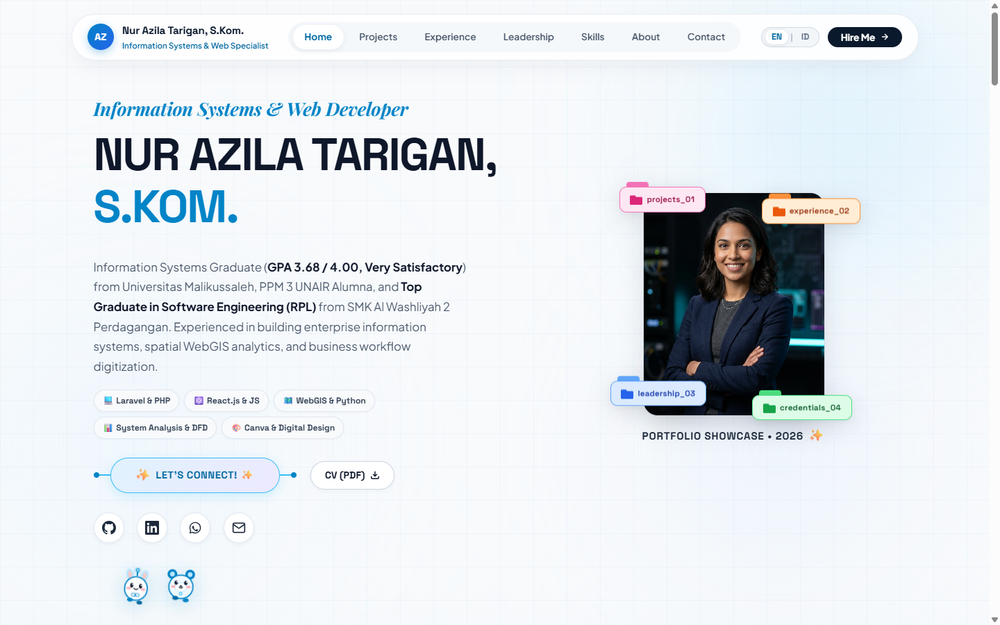

# ✨ Nur Azila Tarigan, S.Kom. — Official Portfolio Website

<div align="center">



[](https://vercel.com)
[](https://developer.mozilla.org/en-US/docs/Web/HTML)
[](https://developer.mozilla.org/en-US/docs/Web/CSS)
[](https://developer.mozilla.org/en-US/docs/Web/JavaScript)
[](LICENSE)

**Spesialis Sistem Informasi | Full-Stack Web Developer | Data & GIS Analyst**  
*Lulusan S1 Sistem Informasi Universitas Malikussaleh (IPK 3,68 / 4,00)*

[🌐 Live Demo (Vercel)](#-deployment--live-url) • [📁 Proyek Unggulan](#-proyek-unggulan) • [💼 Pengalaman](#-pengalaman-profesional--organisasi) • [📫 Kontak](#-kontak--kolaborasi)

</div>

---

## 📌 Tentang Portofolio

Website portofolio ini dirancang secara khusus untuk menampilkan profil profesional, rekam jejak akademik, pengalaman industri, kepemimpinan organisasi, serta portofolio proyek rekayasa perangkat lunak dan analisis data dari **Nur Azila Tarigan, S.Kom.**

### 🌟 Fitur Utama Website:
- **🎨 Modern Aesthetic & Glassmorphism Design:** Tampilan bersih (*Clean Sky Ambient Light*), tipografi modern (*Plus Jakarta Sans*, *Playfair Display*, *Space Grotesk*), dan palet warna profesional.
- **🌐 Dual Language Support (ID / EN):** Tombol pengalih bahasa real-time (Bahasa Indonesia & English) tanpa perlu reload halaman.
- **📱 Responsive & Mobile Optimized:** Layout adaptif untuk semua resolusi (Desktop, Tablet, dan Mobile Phone) dengan navigasi drawer sentuh yang mulus.
- **⚡ Filter Proyek Interaktif:** Filter kategori proyek (*Semua, Web Enterprise, WebGIS & AI, UI/UX Design*).
- **📄 Download CV / Resume:** Unduh ringkasan riwayat hidup resmi langsung dari antarmuka web.
- **🚀 Ultra-Fast & Zero Dependencies:** Dibangun dengan Vanilla HTML5, CSS3 kustom, dan Vanilla ES6+ JavaScript untuk kecepatan muat optimal (100% Google PageSpeed ready).

---

## 🛠️ Tech Stack & Alat Pengembangan

| Kategori | Teknologi & Tools |
| :--- | :--- |
| **Frontend Web** | HTML5 Semantic, Modern CSS3 (CSS Variables, Flexbox, CSS Grid), Vanilla JavaScript (ES6+) |
| **Desain & Aset** | Figma, Canva Pro, Glassmorphism UI Components |
| **Hosting & CI/CD** | Vercel Platform, Git, GitHub |
| **Bahasa & Backend** | PHP (Laravel), Python (Flask/Django), Node.js, RESTful API |
| **Basis Data** | MySQL, PostgreSQL |
| **Data Science & GIS** | Leaflet.js, GeoDa, Pandas, Scikit-learn, Facebook Prophet |

---

## 🚀 Proyek Unggulan

<div align="center">

| Proyek | Deskripsi | Tautan / Demo |
| :--- | :--- | :--- |
| **Tabsy App** | Aplikasi produktivitas ruang kerja dan manajemen tab modern untuk efisiensi alur kerja browser. | [tabsyapp.vercel.app](https://tabsyapp.vercel.app) |
| **OrderFlow Enterprise** | Platform sistem informasi pengadaan barang (procurement) dan monitoring inventaris B2B. | [orderflow-enterprise.vercel.app](https://orderflow-enterprise.vercel.app) |
| **Lapor Pak! PTPN IV** | Sistem pelaporan aspirasi, aduan operasional, dan kepatuhan internal karyawan PTPN IV Regional II. | [GitHub Repository](https://github.com/Azilatarigan01/laporpak-ptpn4) |
| **WebGIS Tuberkulosis Aceh Utara** | Sistem informasi geografis prediksi spasial sebaran kasus TB menggunakan Moran's I & Machine Learning. | [GitHub Repository](https://github.com/Azilatarigan01/webgis_tbacehutara) |
| **E-Learning SMA Tuna Bangsa** | Learning Management System terpadu dengan modul materi, penugasan, dan evaluasi CBT berbasis Laravel. | [GitHub Repository](https://github.com/Azilatarigan01/laravel) |
| **RFID Smart Campus Monitoring** | Prototipe presensi otomatis mahasiswa berbasis IoT RFID dilengkapi pengambilan foto wajah verifikasi. | Riset IoT Smart Campus |

</div>

---

## 💼 Pengalaman Profesional & Organisasi

- **IT Developer Intern — PT Perkebunan Nusantara (PTPN IV) Regional II** (Jan 2025 – Feb 2025)
  - Merancang sistem portal aduan terintegrasi (*Lapor Pak!*) dan otomasi alur kerja administrasi personel.
- **IT Support Intern — PT Industri Nabati Lestari (INL) KEK Sei Mangkei** (Des 2021 – Mar 2022)
  - Mengelola operasional Odoo ERP, verifikasi rekonsiliasi data produksi kilang sawit, dan technical support.
- **Bendahara Kelompok — Pertukaran Mahasiswa Merdeka (PMM 3) Universitas Airlangga (UNAIR)** (2023)
  - Mengelola anggaran operasional dan menyusun pertanggungjawaban dana kegiatan Modul Nusantara.
- **Kepala Departemen Kewirausahaan — BEM Fakultas Teknik Universitas Malikussaleh** (2023 – 2024)
  - Memimpin divisi usaha fakultas, perencanaan program kerja, dan pelaporan keuangan.
- **Head of Administrasi Relawan — Posko Tanggap Bencana Banjir Aceh Tamiang**
  - Mengkoordinasikan pendataan korban, verifikasi inventaris bantuan, dan logistik lapangan.

---

## 💻 Menjalankan Secara Lokal

1. **Clone repository ini:**
   ```bash
   git clone https://github.com/Azilatarigan01/portofolio-.git
   cd portofolio-
   ```

2. **Buka langsung di browser:**
   - Cukup buka file `index.html` dengan klik dua kali, atau
   - Gunakan extension **Live Server** di VS Code, atau
   - Jalankan local server via Python/Node:
     ```bash
     # Menggunakan Python
     python -m http.server 3000
     ```
   - Buka `http://localhost:3000` di browser Anda.

---

## ☁️ Deployment ke Vercel

Repository ini telah dikonfigurasi dengan file `vercel.json` sehingga langsung siap di-deploy ke Vercel.

### Cara Deploy Cepat via Vercel Dashboard:
1. Masuk ke [vercel.com](https://vercel.com).
2. Klik **Add New...** ➜ **Project**.
3. Hubungkan akun GitHub Anda dan pilih repositori `portofolio-`.
4. Pada **Build & Output Settings**, biarkan default (karena merupakan static web).
5. Klik **Deploy** 🚀.

### Atau Deploy via Terminal (Vercel CLI):
```bash
npx vercel --prod
```

---

## 📫 Kontak & Kolaborasi

- 📧 **Email:** [azilatgrn01@gmail.com](mailto:azilatgrn01@gmail.com)
- 💼 **LinkedIn:** [linkedin.com/in/nurazilatarigan](https://www.linkedin.com/in/nurazilatarigan)
- 🐙 **GitHub:** [github.com/Azilatarigan01](https://github.com/Azilatarigan01)
- 💬 **WhatsApp:** [+62 821-7281-2663](https://wa.me/6282172812663)
- 📍 **Domisili:** Lhokseumawe / Aceh Utara, Indonesia

---

<div align="center">
  <sub>Hak Cipta © 2026 Nur Azila Tarigan, S.Kom. Dilindungi Undang-Undang.</sub>
</div>
